# IA embarquée sur un SoC FPGA Zynq : délégation des couches Dense d'un MLP AIfES à un accélérateur PL sur mesure

**Co-conception matérielle/logicielle d'un accélérateur de produits scalaires fp32 (AXI4-Lite + AXI4-Stream), piloté par une application bare-metal ARM Cortex-A9 qui exécute le framework AIfES sur une ZedBoard (Zynq-7000, XC7Z020).**

> Projet d'ingénierie — IA embarquée / SoC FPGA. Outils : AIfES 2.x, Keras/TensorFlow, AMD Vivado et Vitis 2026.1, STM32CubeIDE.

---

## Table des matières

1. [Résumé et mots-clés](#1-résumé-et-mots-clés)
2. [Introduction et motivation](#2-introduction-et-motivation)
3. [Objectifs du projet et contribution](#3-objectifs-du-projet-et-contribution)
4. [Implémentations préliminaires (configurations de référence)](#4-implémentations-préliminaires-configurations-de-référence)
   - [4.1 STM32 + AIfES (sans accélération matérielle)](#41-stm32--aifes-sans-accélération-matérielle)
   - [4.2 ZedBoard + AIfES sur l'ARM seul (sans PL)](#42-zedboard--aifes-sur-larm-seul-sans-pl)
5. [Architecture hybride ARM + FPGA proposée](#5-architecture-hybride-arm--fpga-proposée)
   - [5.1 Principe et partitionnement matériel/logiciel](#51-principe-et-partitionnement-matériellogiciel)
   - [5.2 Pourquoi cette architecture ?](#52-pourquoi-cette-architecture-)
   - [5.3 L'accélérateur matériel sur mesure](#53-laccélérateur-matériel-sur-mesure)
   - [5.4 Communication et coopération ARM–PL](#54-communication-et-coopération-armpl)
   - [5.5 Intégration matérielle avec Vivado](#55-intégration-matérielle-avec-vivado)
   - [5.6 Développement logiciel avec Vitis](#56-développement-logiciel-avec-vitis)
   - [5.7 Rôle des scripts Python](#57-rôle-des-scripts-python)
6. [Flux complet de développement et d'inférence](#6-flux-complet-de-développement-et-dinférence)
7. [Résultats expérimentaux et validation](#7-résultats-expérimentaux-et-validation)
10. [Conclusion](#10-conclusion)
11. [Structure du dépôt](#11-structure-du-dépôt)
12. [Instructions de compilation et de déploiement](#12-instructions-de-compilation-et-de-déploiement)
14. [Références](#14-références)

---

## 1. Résumé et mots-clés

L'inférence de réseaux de neurones sur de petits processeurs embarqués est limitée par la puissance de calcul, la consommation et la mémoire. Ce projet étudie comment la logique programmable (PL) d'un SoC Zynq-7000 peut décharger l'ARM Cortex-A9 des opérations les plus coûteuses d'un perceptron multicouche (MLP), **sans abandonner un framework de ML embarqué standard**. Le réseau est un classifieur MNIST 784-128-64-10 (109 386 paramètres float32) exécuté par [AIfES](https://github.com/Fraunhofer-IMS/AIfES_for_Arduino) (Fraunhofer IMS). Une IP RTL sur mesure, `MAC_Dense_Layer`, calcule en virgule flottante simple précision les produits scalaires $y_j=\sum_k x_k\,W^{T}_{j,k}$ de chaque couche Dense. Elle est commandée par AXI4-Lite et alimentée par un DMA AXI via AXI4-Stream. AIfES garde la main sur le modèle, les activations et l'orchestration ; un petit driver bare-metal (`hw_dense.c`) est accroché à la routine de multiplication matricielle d'AIfES et bascule de façon transparente en logiciel quand la PL ne peut pas être utilisée.

La conception a été validée par simulation RTL, par un auto-test matériel à réponse connue au démarrage, et par une évaluation de 100 images MNIST sur la ZedBoard où la PL a calculé les 300 appels de couches Dense (3 couches × 100 images) sans aucun repli. Deux configurations de référence (STM32 et ARM seul) servent de points de comparaison.

**Mots-clés :** IA embarquée · Edge ML · AIfES · SoC FPGA · Zynq-7000 · ZedBoard · Co-conception matériel/logiciel · DMA AXI · AXI4-Stream · MAC en virgule flottante · Vivado · Vitis · MNIST

---

## 2. Introduction et motivation

**IA embarquée.** Exécuter l'inférence en périphérie évite d'envoyer les données brutes dans le cloud, réduit la latence et protège la vie privée. En contrepartie, il faut composer avec les contraintes des systèmes embarqués : calcul et mémoire limités, budget énergétique serré, comportement temps réel et choix restreint de ressources matérielles.

**Pourquoi un SoC FPGA.** Un composant Zynq-7000 associe un *Processing System* (PS) à deux cœurs ARM Cortex-A9 et une matrice FPGA, la *Programmable Logic* (PL), reliés par des ports AXI sur la même puce. Le processeur apporte la souplesse du logiciel (frameworks, protocoles, flot de contrôle). La matrice FPGA permet de construire des chemins de données propres à l'application, dont le parallélisme et le format numérique sont choisis par le concepteur.

**Pourquoi AIfES.** AIfES est un framework C conçu pour les microcontrôleurs : il n'exige aucune allocation dynamique pendant l'inférence, un modèle Keras peut y être exporté avec l'*AIfES-Converter*, et les noyaux de calcul sont isolés dans un petit nombre de fonctions (`aimath_f32_default_*`). Cette dernière propriété permet de remplacer le noyau le plus lourd par un appel matériel sans toucher au reste du framework.

**Problématique.** *Comment exploiter la capacité de calcul parallèle et pipelinée d'un FPGA pour accélérer les opérations les plus coûteuses d'un réseau de neurones, tout en gardant la souplesse logicielle d'un processeur ARM Cortex et le fonctionnement du framework AIfES ?*

---

## 3. Objectifs du projet et contribution

| # | Objectif | État dans le dépôt |
|---|----------|--------------------|
| O1 | Entraîner un MLP MNIST et le déployer avec AIfES sur un microcontrôleur | Fait (STM32L4R9) — référence |
| O2 | Exécuter le même modèle avec AIfES sur l'ARM de la ZedBoard | Application fournie (`AIFES_PS`) — référence |
| O3 | Concevoir un accélérateur PL sur mesure pour les couches Dense | Fait (`MAC_Dense_Layer.v`) |
| O4 | L'intégrer au PS du Zynq (block design Vivado) | Fait (`AIfES_Accel`) |
| O5 | L'intégrer à AIfES sans modifier le modèle | Fait (`hw_dense.c` + 1 hook dans `aimath_f32_default.c`) |
| O6 | Valider fonctionnellement sur la carte | Fait (auto-test + 100 images) |


**Contribution principale.** La contribution porte sur l'intégration matérielle/logicielle, pas sur le réseau de neurones lui-même : un accélérateur sur mesure basé sur AXI, son interface de registres, un chemin de données par DMA, un driver bare-metal qui gère le cache, et un hook non intrusif dans AIfES avec repli logiciel.

---

## 4. Implémentations préliminaires (configurations de référence)

Ces deux configurations sont des **références** et ne font pas partie de la contribution du projet. Elles valident le modèle et la chaîne d'outils avant l'arrivée de l'accélérateur. Le même modèle (`aifes_f32_weights.h`, identique octet pour octet dans `AIFES_1` et `AIFES_PS`), le même script hôte et le même protocole UART sont utilisés partout.

### 4.1 STM32 + AIfES (sans accélération matérielle)

| Élément | Valeur |
|---|---|
| Cible | STM32L4R9 (Cortex-M4F), STM32CubeIDE avec une horloge 120 MHz |
| Framework | AIfES 2.2.0, sources allégées dans `AIfES_stm32/Middlewares/AIfES` |
| Modèle | 784 → 128 (ReLU) → 64 (ReLU) → 10 (Softmax), float32, 109 386 paramètres |
| Mémoire | 472,17 Ko de flash (23,06 %), 19,33 Ko de RAM (3,02 %) |
| Liaison avec le PC | USART2 via le port COM virtuel du ST-LINK, 115 200 bauds |
| Prétraitement | `(pixel / 255) − 0.5`, effectué sur l'hôte |

Le script PC envoie une image à la fois (784 × float32) ; le microcontrôleur n'exécute que la passe avant et renvoie les dix valeurs softmax quantifiées sous la forme `round(p·255)`. L'hôte conserve le jeu de données, les étiquettes réelles et le calcul de la précision. Un premier modèle à 5 couches (2,3 Mo) ne tenait pas en flash et a été remplacé par le modèle réduit ci-dessus.

**Ce que cela démontre.** L'inférence embarquée avec AIfES est faisable sur un microcontrôleur (97 % sur 100 images d'après le rapport précédent). **Limites :** un seul cœur scalaire, aucun parallélisme matériel, et une taille de modèle bornée par la flash disponible.

### 4.2 ZedBoard + AIfES sur l'ARM seul (sans PL)

Le dossier `AIFES_PS` est un projet Vitis dont la plateforme (`AIFES_PS/AIfES_Platform/hw/AIfES_1_wrapper.xsa`) est construite à partir d'un **block design qui ne contient que le bloc `processing_system7`**, sans logique PL ni bitstream. L'application `main_AIfES.c` est l'application hybride privée de son driver : même protocole UART, même modèle et mêmes sources AIfES, mais `aimath_f32_default.c` ne porte aucun hook et `USE_HW_DENSE` n'est pas défini, de sorte que chaque couche Dense s'exécute dans la boucle C d'origine d'AIfES sur le Cortex-A9.

**Rôle.** C'est la référence logicielle sur la ZedBoard : elle valide le modèle, le flux Vitis et la liaison UART sur la plateforme cible avant l'ajout d'un accélérateur, et c'est la configuration à laquelle la conception hybride devra être comparée.

---

## 5. Architecture hybride ARM + FPGA proposée

C'est le cœur du projet : AIfES tourne sur le Cortex-A9 avec un accélérateur sur mesure dans la PL, et les deux coopèrent à chaque inférence.

### 5.1 Principe et partitionnement matériel/logiciel

<p align="center">
  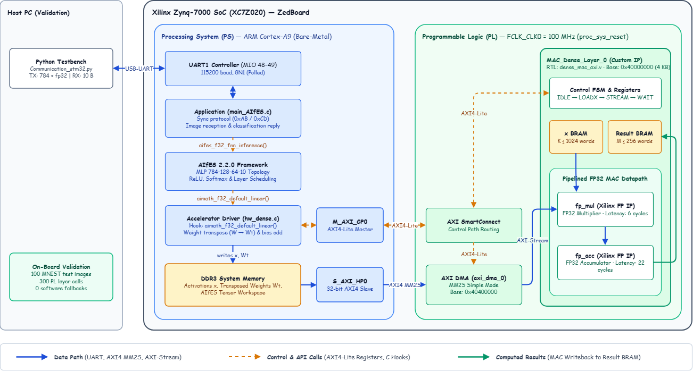<br>
  <em>Figure 1 — Architecture du système.</em>
</p>

Le Cortex-A9 exécute une application bare-metal (`main_AIfES.c`) et AIfES. AIfES construit le modèle (`aifes_f32_fnn.h`), gère les couches et la mémoire d'inférence, et appelle ses noyaux. Pour évaluer une couche Dense, il appelle `aimath_f32_default_linear()`. Dans le projet hybride, cette fonction commence par appeler `hw_dense_linear_f32()` ; si le chemin PL accepte la couche, le produit matriciel est calculé dans la PL, sinon la boucle logicielle d'origine s'exécute. Seuls les **produits scalaires** sont délégués.

<p align="center">
  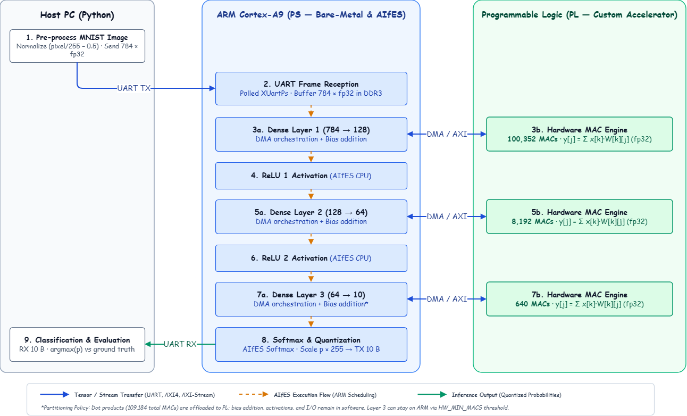<br>
  <em>Figure 2 — Répartition des tâches pour une inférence</a></em>
</p>

| Opération | Exécutée sur | Preuve |
|---|---|---|
| Protocole UART, réception des images, argmax, réponse | ARM (PS) | `main_AIfES.c` |
| Construction du modèle, ordonnancement des couches, mémoire d'inférence | ARM (AIfES) | `aifes_f32_fnn.h` |
| Transposition des poids $W\rightarrow W^T$ (une fois par couche), maintenance du cache, programmation du DMA et des registres | ARM (`hw_dense.c`) | `get_wt()`, `dma_send()`, `hw_run()` |
| **Produits scalaires** $y_j=\sum_k x_k W^T_{j,k}$ des 3 couches Dense | **PL** (`MAC_Dense_Layer`) | RTL |
| Ajout du biais $y_j \mathrel{+}= b_j$ | ARM | `hw_dense_linear_f32()` |
| ReLU, Softmax | ARM (AIfES) | non touchées par le hook |

Il ne s'agit donc pas d'un simple « ARM à côté d'un FPGA » : pendant une inférence, le processeur et la PL s'échangent contrôle, données et résultats à chaque couche Dense, et aucun des deux ne produit seul la sortie.

### 5.2 Pourquoi cette architecture ?

**Pourquoi garder AIfES sur l'ARM ?** AIfES fournit la description du modèle, l'ordonnancement des couches, les activations et le flux de conversion depuis Keras. Le conserver signifie que tout modèle qu'il prend en charge continue de *fonctionner* et que les en-têtes générés s'utilisent tels quels. Réimplémenter le framework en RTL ferait perdre cette souplesse.


**Pourquoi déléguer les produits scalaires ?** Les couches Dense dominent l'arithmétique : $784\times128=100\,352$, $128\times64=8\,192$ et $64\times10=640$ multiplications-accumulations, soit **109 184 MAC par inférence** (le chiffre qui dimensionne le pool de poids dans `hw_dense.c`), contre quelques centaines d'opérations élément par élément pour ReLU et Softmax. Un MAC est une opération régulière qui se prête bien à un chemin de données flottant pipeliné, et c'est le noyau qu'AIfES isole dans une seule fonction.

**Pourquoi garder le biais, les activations et le contrôle en logiciel ?** Ces opérations sont peu coûteuses, irrégulières ou transcendantes (Softmax) ; les mettre dans la PL augmenterait la surface et la complexité de conception pour un gain faible, et les laisser sur l'ARM préserve le comportement d'AIfES pour tous les autres types de couches.

### 5.3 L'accélérateur matériel sur mesure

L'accélérateur est le module Verilog `MAC_Dense_Layer`.

**Fonction.** Pour une couche, il calcule $y_j=\sum_{k=0}^{K-1} x_k\,W^T_{j,k}$ pour $j=0\ldots M-1$, avec $K\le1024$ (`MAX_K`) et $M\le256$ (`MAX_M`). Le biais **n'est pas** ajouté dans la PL.

**Interfaces.**

| Interface | Direction | Rôle |
|---|---|---|
| `aclk`, `aresetn` | entrée | `FCLK_CLK0` à 100 MHz ; reset actif à l'état bas issu du *Processor System Reset* |
| `s_axi_*` (esclave AXI4-Lite, adresse sur 12 bits) | PS → PL | registres de contrôle et lecture des résultats ; mappé à `0x4000_0000`, 4 Ko |
| `s_axis_*` (esclave AXI4-Stream, 32 bits) | DMA → PL | vecteur d'entrée $x$, puis poids transposés |

**Carte des registres** (d'après le RTL) :

| Offset | Nom | Accès | Contenu |
|---|---|---|---|
| `0x00` | CTRL | W | bit 0 = START (accepté uniquement en IDLE) |
| `0x04` | STATUS | R | bit 0 BUSY, bit 1 DONE (effacé par START), bit 2 ERR (K ou M hors plage) |
| `0x08` | K | RW | 1…1024 |
| `0x0C` | M | RW | 1…256 |
| `0x10` | CYCLES | R | cycles d'horloge entre START et DONE pour la dernière exécution |
| `0x800 + 4·j` | RESULT[j] | R | résultat fp32 $y_j$ |

**Format des données.** Tout est en simple précision IEEE-754 (mots de 32 bits), le format déjà utilisé par les noyaux `f32` d'AIfES. L'arithmétique est assurée par deux cœurs IP Xilinx *Floating-Point Operator* configurés dans `AIfES_dense_IP` (`fp_mul` : simple précision, multiplication, latence 6, non bloquant ; `fp_acc` : simple précision, accumulateur, latence 22, non bloquant, `TLAST` propagé depuis l'entrée A). Il n'y a ni conversion en virgule fixe ni quantification.

**Fonctionnement interne.** Une FSM à quatre états pilote le chemin de données :

1. `S_IDLE` — attend START ; vérifie $0<K\le1024$ et $0<M\le256$ (sinon positionne ERR).
2. `S_LOADX` — accepte $K$ mots du flux dans `x_mem` (une RAM de blocs de 1024 × 32 bits).
3. `S_STREAM` — accepte $M\cdot K$ mots, c'est-à-dire la ligne $j$ de $W^T$ après la ligne $j-1$. Chaque mot est enregistré avec le $x_k$ correspondant lu dans `x_mem`, et marqué `TLAST` sur le dernier mot de la ligne (l'IP compte elle-même les mots et ignore le `TLAST` du flux).
4. `S_WAIT` — attend que l'accumulateur ait livré le résultat de la dernière ligne.

Chaque produit $x_k\,w_{j,k}$ passe par `fp_mul`, puis dans `fp_acc`, qui accumule jusqu'au marqueur `TLAST` et émet $y_j$ ; celui-ci est stocké dans `res_mem` (RAM de blocs de 256 × 32 bits). Quand les $M$ résultats sont stockés, `DONE` est levé et la FSM retourne à IDLE. `s_axis_tready` est à 1 pendant LOADX et STREAM : le chemin de données consomme donc **un mot de flux par cycle d'horloge** (un seul multiplieur).

**Synchronisation.** Il n'y a pas d'interruption : la PL signale la fin dans STATUS.DONE et le processeur fait du polling dessus. Le contrôle de flux sur le flux de données repose sur `TVALID/TREADY` d'AXI4-Stream.

**Simulation.** `tb_dense_mac_axi.v` pilote l'IP avec $K=8$, $M=4$ (écritures AXI4-Lite, flux de $x$ puis de $W^T$, polling de STATUS, lecture de CYCLES et des résultats) et compare à une référence calculée dans le testbench, avec une tolérance de $10^{-3}$. Il affiche `TEST PASSED` (Figure 8).

### 5.4 Communication et coopération ARM–PL

<p align="center">
  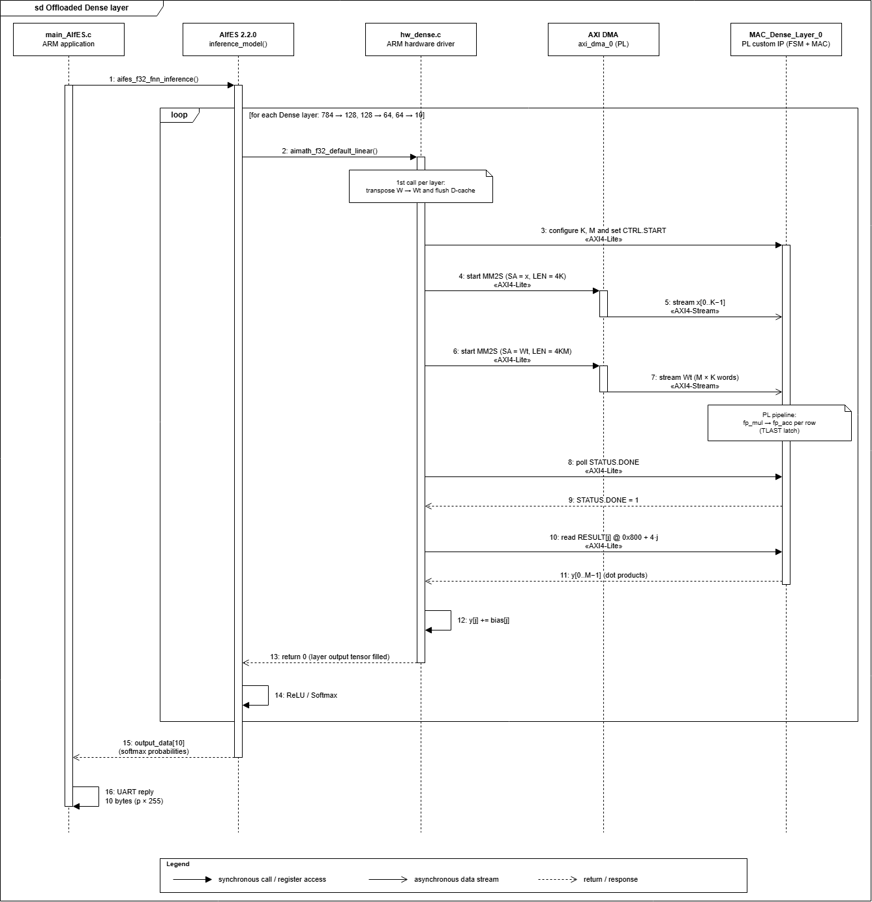<br>
  <em>Figure 3 — Séquence d'une couche Dense déléguée à la PL</em>
</p>

Les mécanismes réellement utilisés sont **AXI4-Lite** (contrôle, état, lecture des résultats, via `M_AXI_GP0`), le **DMA AXI en mode simple, canal MM2S uniquement** (DDR → AXI4-Stream, lectures via `S_AXI_HP0`) et le **polling**. Il n'y a ni interruptions, ni scatter-gather, ni canal S2MM (PL → DDR), ni mémoire partagée sur puce.

Flux de données d'une inférence (répété pour chacune des trois couches Dense) :

1. **Initialisation** (une seule fois). `aifes_f32_fnn_create_model()` construit le modèle, les poids restent dans `.rodata` en DDR ; `hw_dense_selftest()` exécute un test à réponse connue et désactive le chemin PL en cas d'échec.
2. **Préparation.** À la première utilisation d'une couche, `get_wt()` transpose le $W[K][M]$ d'AIfES en $W^T[M][K]$ (pour que les poids d'un neurone de sortie soient contigus dans le flux), le range dans un pool statique de 480 Ko et le vide du cache de données. Le vecteur d'entrée $x$ est vidé du cache à chaque appel, car le DMA sur HP0 n'est pas cohérent avec le cache.
3. **Configuration et démarrage.** Le driver écrit $K$ et $M$, puis START.
4. **Transfert de $x$.** Le DMA lit $x$ ($4K$ octets) en DDR et l'envoie dans `x_mem` de l'IP ; le driver fait du polling sur l'état du DMA (IOC).
5. **Transfert de $W^T$ et calcul.** Un second transfert DMA envoie $4KM$ octets ; la PL multiplie et accumule chaque ligne au fur et à mesure que les données arrivent.
6. **Synchronisation.** Le driver fait du polling sur STATUS.DONE (avec un délai maximal ; les erreurs correspondent aux codes −3…−6).
7. **Récupération des résultats.** Le driver lit CYCLES et les $M$ résultats à `0x800 + 4·j` via AXI4-Lite.
8. **Réutilisation.** Le biais est ajouté sur l'ARM, le tenseur retourne à AIfES, qui applique ReLU ou Softmax et passe à la couche suivante. Après la dernière couche, `main_AIfES.c` extrait l'argmax et répond sur l'UART.

Si le chemin PL est désactivé, si une couche dépasse $K>1024$ ou $M>256$, si le pool de poids est plein, ou en cas d'erreur ou de dépassement de délai, le hook renvoie « non traité » et AIfES exécute sa boucle logicielle pour cette couche ; les compteurs `g_hw_calls`, `g_hw_fallbacks` et `g_hw_last_err` gardent la trace de ce qui s'est passé.

### 5.5 Intégration matérielle avec Vivado

<p align="center">
  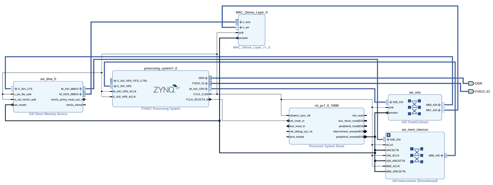<br>
  <em>Figure 4 — Block design sous Vivado </em>
</p>

Le block design `design_1` (`AIfES_Accel`) contient les blocs suivants:

| Bloc | Configuration | Rôle |
|---|---|---|
| `processing_system7_0` | `FCLK_CLK0` = 100 MHz ; `M_AXI_GP0` et `S_AXI_HP0` (32 bits) activés ; CPU à 666,67 MHz | Sous-système ARM, accès à la DDR |
| `axi_dma_0` | MM2S uniquement (`c_include_s2mm = 0`), sans scatter-gather | Lit la DDR, alimente le flux |
| `MAC_Dense_Layer_0` | IP sur mesure `xilinx.com:user:MAC_Dense_Layer:1.0` | L'accélérateur |
| `axi_smc` (SmartConnect) | `GP0` → contrôle du DMA et de l'IP | Routage AXI4-Lite |
| `axi_mem_intercon` | `DMA M_AXI_MM2S` → `S_AXI_HP0` | Chemin de données vers la DDR |
| `rst_ps7_0_100M` | reset issu de `FCLK_RESET0_N` | reset synchronisé, actif à l'état bas |


<p align="center">
  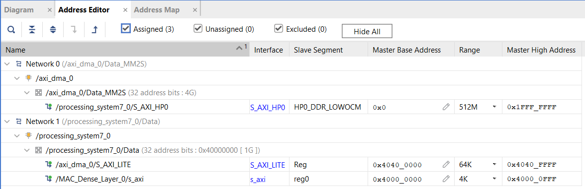<br>
  <em>Figure 5 — Address Editor</em>
</p>


### 5.6 Développement logiciel avec Vitis

Le workspace Vitis est `AIFES_1` :

- **Plateforme** `AIfES_Platform`, créée à partir de `AIfES.xsa` (voir `AIfES_Platform/vitis-comp.json`) : BSP standalone pour le Cortex-A9, FSBL, `ps7_init`. Le BSP fournit `xil_io.h` et `xil_cache.h`, utilisés par le driver.
- **Application** `AIfES_component`, construite avec CMake (`src/UserConfig.cmake`) : elle définit `USE_HW_DENSE`, inclut `hw_dense.c` et les sources AIfES.
- **`aimath_f32_default.c`** reçoit la seule modification apportée au framework : sous `#ifdef USE_HW_DENSE`, `aimath_f32_default_linear()` appelle `hw_dense_linear_f32()` et retourne si celle-ci signale un succès.
- **`hw_dense.c/.h`** est le driver : adresses de base `HW_DENSE_BASE = 0x40000000`, `HW_DMA_BASE = 0x40400000`, limites alignées sur le RTL (`HW_MAX_K`, `HW_MAX_M`), pool de transposition des poids, `dma_send()` (MM2S en mode simple), `hw_run()`, l'auto-test et les variables de débogage.
- **`main_AIfES.c`** implémente le protocole UART (`XUartPs` en polling, 115 200 bauds), chronomètre l'inférence avec le timer global du Cortex-A9, et expose `g_status`, `g_images_done`, `g_last_infer_us` et les compteurs `g_hw_*` pour le débogueur.

Taille du binaire affichée dans la console Vitis : `text` 578 739 o, `data` 2 800 o, `bss` 507 312 o (dominé par le pool de poids de 480 000 o).

### 5.7 Rôle des scripts Python

| Script | Phase | Fonction |
|---|---|---|
| `emnist_aifes.ipynb` | hors ligne | Charge MNIST, le normalise et l'équilibre, entraîne le modèle Keras 784-128-64-10 (Adam, 20 époques, lots de 128), le sauvegarde, puis le convertit avec `keras2aifes.convert_to_fnn_f32` (AIfES-Converter) pour produire les en-têtes C. |
| `Communication_stm32.py` | à l'exécution (PC hôte) | Ouvre le port série, se synchronise (`0xAB` → `0xCD`), envoie 100 images de test en float32 depuis `MNIST_xtest_NN_C2_16_10.npy`, lit les 10 octets renvoyés, prend l'argmax, compare avec `MNIST_ytest_NN_C2_16_10.npy` et affiche la précision cumulée. |


---

## 6. Flux complet de développement et d'inférence

<p align="center">
  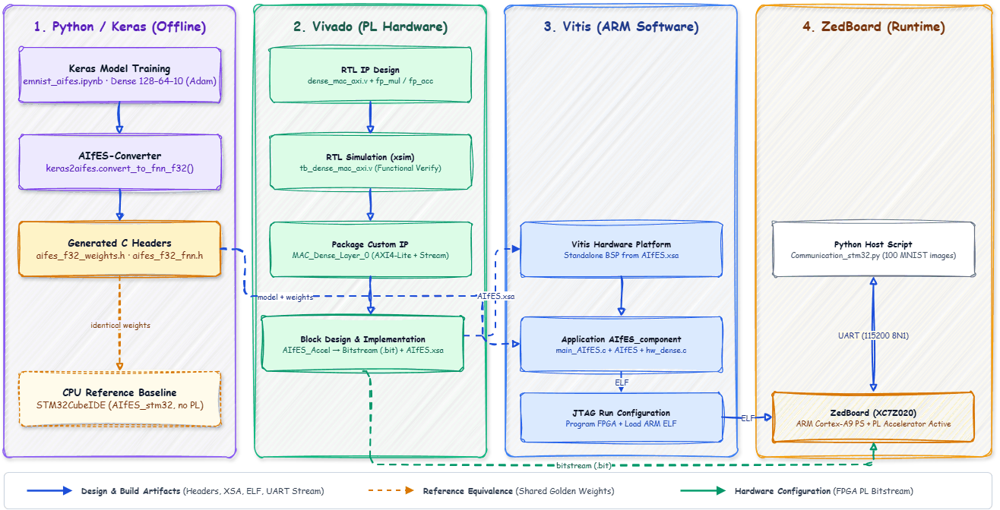<br>
  <em>Figure 5 — Du modèle entraîné à l'inférence sur la ZedBoard.</em>
</p>

| Étape | Outil | Sortie | Dépend de |
|---|---|---|---|
| 1. Entraîner et convertir le modèle | Python / Keras / AIfES-Converter | `aifes_f32_weights.h`, `aifes_f32_fnn.h`, données de test `.npy` | — |
| 2. Concevoir et simuler l'IP | Vivado (`AIfES_dense_IP`) | `MAC_Dense_Layer.v`, `fp_mul`, `fp_acc`, testbench | — |
| 3. Construire le block design, implémenter | Vivado (`AIfES_Accel`) | bitstream, `AIfES.xsa` | étape 2 |
| 4. Créer la plateforme et l'application | Vitis (`AIFES_1`) | `AIfES_component.elf` | étapes 1 et 3 (en-têtes, XSA, adresses) |
| 5. Déployer et exécuter | ZedBoard (JTAG), Vitis Run/Debug | PL programmée, ELF en cours d'exécution | étape 4 |
| 6. Valider | PC hôte avec `Communication_stm32.py` | prédiction par image, précision | étape 5 |


---

## 7. Résultats expérimentaux et validation

### 7.1 Synthèse des trois configurations

| | 1. STM32 + AIfES | 2. ZedBoard, ARM seul | 3. ZedBoard, ARM + PL (hybride) |
|---|---|---|---|
| Dossier du projet | `AIfES_stm32` | `AIFES_PS` | `AIFES_1` (matériel : `AIfES_Accel`) |
| Processeur | Cortex-M4F, 120 MHz | Cortex-A9, 666,67 MHz | Cortex-A9, 666,67 MHz + PL à 100 MHz |
| Couches Dense exécutées sur | CPU | CPU | **PL** (repli logiciel possible) |
| Rôle du processeur | tout | tout | orchestration, préparation, biais, activations, E/S |
| Rôle de la PL | — | — | produits scalaires (MAC fp32) |
| Validation disponible | 97 % sur 100 images | 96 % sur 100 images | 96 % sur 100 images |

### 7.2 Configuration hybride — validation sur la carte

<p align="center">
  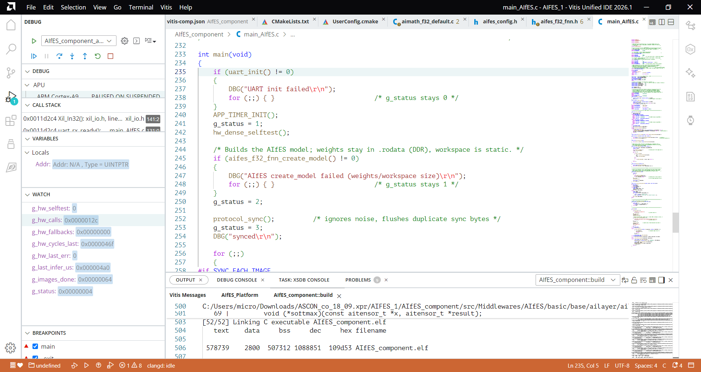<br>
  <em>Figure 6a — Session de débogage Vitis de l'application hybride après une exécution de 100 images.</em>
</p>

Valeurs observées dans le débogueur (en hexadécimal sur la capture) :

| Variable | Valeur | Signification |
|---|---|---|
| `g_hw_selftest` | 0 | test à réponse connue de la PL réussi |
| `g_hw_calls` | 0x12C = **300** | couches Dense calculées dans la PL (3 couches × 100 images) |
| `g_hw_fallbacks` | 0 | aucune couche n'est repassée en logiciel |
| `g_hw_last_err` | 0 | aucune erreur PL ou DMA enregistrée |
| `g_images_done` | 0x64 = **100** | images traitées |
| `g_hw_cycles_last` | 0x46F = 1 135 | cycles d'horloge PL (START → DONE) de la dernière couche Dense, soit 11,35 µs à 100 MHz |
| `g_last_infer_us` | 0x4A0 = 1 184 | durée de la dernière inférence, en µs, mesurée sur l'ARM |

Exactement 300 appels PL sans aucun repli montrent que **chaque couche Dense de chaque image a été calculée par l'accélérateur**. C'est la preuve que cette exécution a bien emprunté le chemin PL.

<p align="center">
  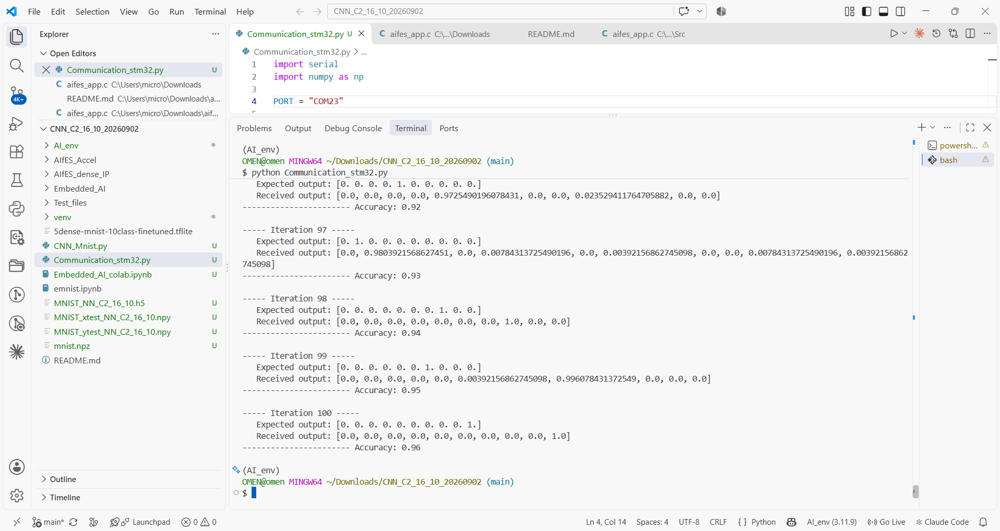<br>
  <em>Figure 6b — Journal d'évaluation côté hôte (<code>Communication_stm32.py</code>, port COM23) : 100 itérations, précision finale 0,96.</em>
</p>

Ce journal, capturé quelques secondes après la vue du débogueur ci-dessus (ce qui correspond à la même exécution de 100 images), montre les dix valeurs softmax renvoyées pour chaque image et une précision cumulée de **0,96 après 100 images**.

**Vraisemblance du temps mesuré.** Le RTL consomme un mot de flux par cycle ; le seul transfert de flux demande donc au moins $(784+100\,352)+(128+8\,192)+(64+640)=110\,160$ mots, soit environ **1,10 ms** à 100 MHz. Les 1,184 ms mesurées sont cohérentes avec une conception limitée par le flux de données.

### 7.3 Résultats d'implémentation matérielle

Résultats post-implémentation de l'ensemble du block design (wrapper PS, DMA, interconnexions, IP), à une horloge de 100 MHz :

| Ressource | Utilisé | Disponible | Taux d'utilisation |
|---|---|---|---|
| Slice LUTs | 1 816 (1 702 logique + 114 mémoire) | 53 200 | 3,41 % |
| Slice registers | 2 468 | 106 400 | 2,32 % |
| Block RAM tiles | 2,5 (2 × RAMB36 + 1 × RAMB18) | 140 | 1,79 % |
| DSP48E1 | 5 | 220 | 2,27 % |

Résumé du timing : pire marge négative (WNS, setup) **3,273 ns**, pire marge de hold 0,071 ns, pire marge de largeur d'impulsion 3,750 ns, aucun point d'arrivée en échec ; toutes les contraintes de timing utilisateur sont respectées à 100 MHz.

<p align="center">
  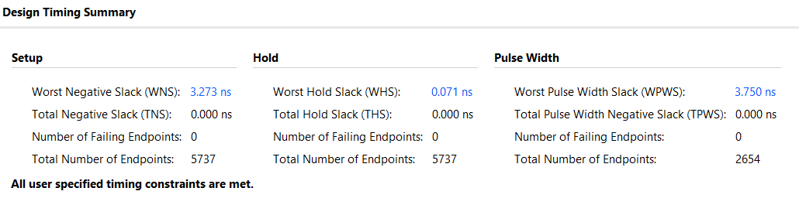
  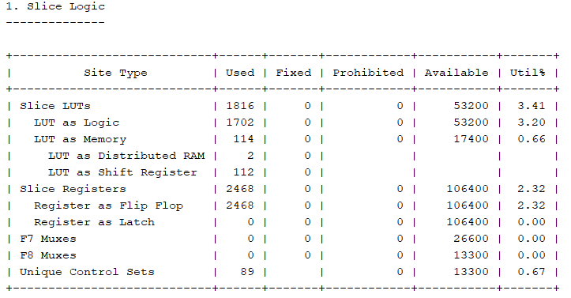<br>
  <em>Figure 7 — Résumé du timing post-implémentation et utilisation de la logique des slices. Tableaux mémoire, DSP et répartition des slices : <a href="docs/images/vivado_util_memory.png">mémoire</a>, <a href="docs/images/vivado_util_dsp.png">DSP</a>, <a href="docs/images/vivado_util_slice_distribution.png">répartition des slices</a>.</em>
</p>

### 7.4 Simulation RTL

<p align="center">
  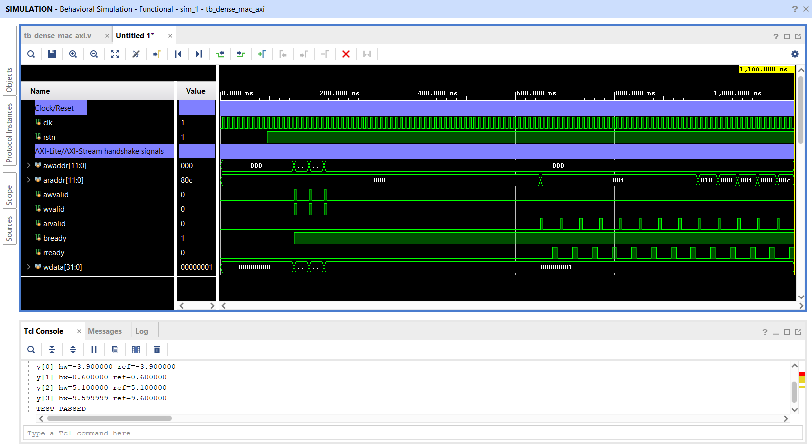<br>
  <em>Figure 8 — Simulation comportementale de l'IP</em>
</p>

La console Tcl affiche `y[0] … y[3]` égaux à la référence (−3,9 ; 0,6 ; 5,1 ; 9,6) et `TEST PASSED`. La trace `araddr` montre le polling de l'état (`0x004`), la lecture de CYCLES (`0x010`) et les lectures de résultats à partir de `0x800`. Comme indiqué plus haut, cette simulation utilise des modèles comportementaux de substitution pour les cœurs en virgule flottante.

### 7.5 Mesures

---

## 10. Conclusion

Le projet démontre une co-conception matérielle/logicielle fonctionnelle sur ZedBoard : AIfES garde la main sur le modèle et sur les couches non linéaires côté ARM, tandis qu'un accélérateur fp32 sur mesure, commandé par AXI, calcule les produits scalaires des couches Dense, piloté par un driver bare-metal qui gère le cache et dispose d'un repli logiciel. L'intégration couvre la conception RTL, le block design Vivado, une plateforme et une application Vitis, ainsi qu'un hook dans le framework. Elle a été validée en simulation, par un auto-test sur la carte et par une exécution de 100 images pendant laquelle la PL a traité les 300 appels de couches Dense. Les configurations STM32 et ARM seul servent de références.

---

## 11. Structure du dépôt

```
.
├── README.md                          Ce rapport
├── Communication_stm32.py             Script hôte (protocole UART, précision sur 100 images)
├── emnist_aifes.ipynb                 Entraînement (Keras) et export AIfES-Converter
├── MNIST_xtest_NN_C2_16_10.npy        Images de test (float32, normalisées)
├── MNIST_ytest_NN_C2_16_10.npy        Étiquettes de test (one-hot)
├── AIfES_stm32/                       Config. 1 : projet STM32CubeIDE (STM32L4R9)
├── AIFES_PS/                          Config. 2 : projet Vitis, ARM seul (XSA PS seul, sans hook)
├── AIfES_dense_IP/                    Projet Vivado de l'IP : RTL, cœurs FP, testbench
│   └── AIfES_dense_IP.srcs/{sources_1/new/MAC_Dense_Layer.v, sim_1/imports/Downloads/}
├── AIfES_Accel/                       Projet Vivado : block design, implémentation, AIfES.xsa
├── AIFES_1/                           Config. 3 : projet Vitis (hybride)
│   ├── AIfES_Platform/                Plateforme générée à partir de AIfES_Accel/AIfES.xsa
│   └── AIfES_component/               main_AIfES.c, hw_dense.c/.h, en-têtes du modèle, src/ (CMake, AIfES)
└── docs/
    ├── STM32_report_fr.md             Ancien rapport STM32 (en français)
    ├── diagrams/                      Diagrammes (.png modifiables dans draw.io, .gif animé)
    └── images/                        Captures d'écran utilisées dans ce rapport
```


## 12. Instructions de compilation et de déploiement

> Reconstitué à partir des fichiers du projet ; le flux n'a pas été rejoué pour rédiger ce document.

**Prérequis :** ZedBoard (Zynq-7020) avec JTAG/USB, USB-UART sur l'UART0 du PS ; Vivado et Vitis 2026.1 ; Python 3 avec `pyserial` et `numpy` ; pour réentraîner, TensorFlow/Keras et l'AIfES-Converter.

1. **(Facultatif) Réentraîner et réexporter.** Lancer `emnist_aifes.ipynb` ; copier les fichiers générés `aifes_f32_weights.h` et `aifes_f32_fnn.h` dans `AIFES_1/AIfES_component/`.
2. **Matériel.** Ouvrir `AIfES_Accel/AIfES_Accel.xpr` dans Vivado, lancer la synthèse, l'implémentation et *Generate Bitstream*, puis exporter le matériel **en incluant le bitstream** (`AIfES.xsa`). L'IP est référencée sous le nom `xilinx.com:user:MAC_Dense_Layer:1.0` ; la source RTL est `MAC_Dense_Layer.v` de `AIfES_dense_IP`. Le dépôt de l'IP Packager ne fait pas partie de l'archive : reconstruire l'IP de zéro revient donc à repackager ce RTL avec les cœurs `fp_mul`/`fp_acc` (`AIfES_dense_IP/.../ip/`).
3. **Logiciel.** Ouvrir le workspace `AIFES_1` dans Vitis, vérifier que la plateforme utilise `AIfES.xsa`, et compiler `AIfES_component` (`USE_HW_DENSE` est défini dans `src/UserConfig.cmake`). Si le block design change, vérifier que `HW_DENSE_BASE` et `HW_DMA_BASE` dans `hw_dense.h` correspondent à l'Address Editor.
4. **Exécution.** Connecter la carte, puis lancer l'application avec *Run* ou *Debug* depuis Vitis (cela programme la PL et charge l'ELF via `ps7_init`). Dans le débogueur, surveiller `g_status` (4 = en service), `g_hw_selftest` (0 = réussi), `g_hw_calls`, `g_hw_fallbacks`.
5. **Évaluation.** Modifier `PORT` en haut de `Communication_stm32.py` pour y mettre le port COM de la carte, puis :
   ```bash
   pip install pyserial numpy
   python Communication_stm32.py
   ```
   Le script se synchronise avec la carte et évalue 100 images.
6. **Références.** ARM seul : ouvrir `AIFES_PS` dans Vitis et l'exécuter de la même façon. STM32 : ouvrir `AIfES_stm32` dans STM32CubeIDE.

---

## 14. Références

1. Fraunhofer IMS, *AIfES — Artificial Intelligence for Embedded Systems*, <https://github.com/Fraunhofer-IMS/AIfES_for_Arduino> ; *AIfES-Converter*, <https://github.com/Fraunhofer-IMS/AIfES-Converter>.
2. AMD/Xilinx, *Zynq-7000 SoC Technical Reference Manual* (UG585).
3. AMD/Xilinx, *AXI DMA LogiCORE IP Product Guide* (PG021).
4. AMD/Xilinx, *Floating-Point Operator LogiCORE IP Product Guide* (PG060).
5. Arm, *AMBA AXI and ACE Protocol Specification* (IHI 0022) et *AMBA 4 AXI4-Stream Protocol Specification* (IHI 0051).
6. Digilent/Avnet, *ZedBoard Hardware User Guide*.
